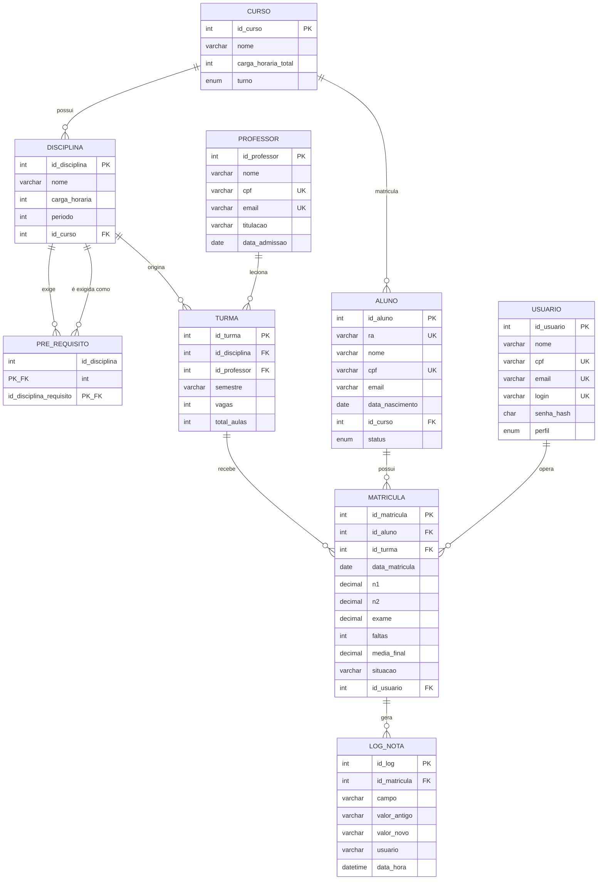

# Sistema de Gestão Acadêmica (SGA) — Faculdade do Bug Infinito (FBI)

## Relatório Técnico

**Instituição:** Faculdade do Bug Infinito (FBI)
**Sistema:** SGA — Sistema de Gestão Acadêmica
**Disciplina:** LBD — Laboratório de Banco de Dados
**Data:** 23/11/2026

**Integrantes:**

| Integrante | Matrícula | Responsabilidades (resumo) |
|---|---|---|
| Manuela Albuquerque Wentz | [matrícula] | Modelagem, schema SQL e normalização |
| Danieli Cristina de Carvalho Breves | 20250030121 | Procedures, functions, triggers e testes SQL |
| Fernando Riad da Silva Ribeiro | [matrícula] | Aplicação Python (telas, integração, criptografia) |
| Nickson Henrique Cavéquia Silva | [matrícula] | Relatório, apresentação, views e segurança/perfis |

> Observação: **Professor:** Francisco Sanches Banhos Filho. A matrícula de
> Danieli já está preenchida (Sistemas de Informação · danieli.breves@unemat.br);
> completar as dos demais integrantes antes da entrega. O detalhamento da
> divisão encontra-se na Seção 16 e em `docs/divisao_trabalho.md`.

---

## Sumário

1. [Introdução](#1-introducao)
2. [Objetivos](#2-objetivos)
3. [Metodologia e ferramentas](#3-metodologia-e-ferramentas)
4. [Modelagem de dados — MER textual](#4-modelagem-de-dados--mer-textual)
5. [Modelo Lógico Relacional](#5-modelo-logico-relacional)
6. [Diagrama — código Mermaid e importação](#6-diagrama--codigo-mermaid-e-importacao)
7. [Justificativa da Terceira Forma Normal (3FN)](#7-justificativa-da-terceira-forma-normal-3fn)
8. [Implementação física — tabelas e restrições](#8-implementacao-fisica--tabelas-e-restricoes)
9. [Objetos programáveis — procedures, views, functions e triggers](#9-objetos-programaveis--procedures-views-functions-e-triggers)
10. [Segurança — criptografia de senhas e perfis de acesso](#10-seguranca--criptografia-de-senhas-e-perfis-de-acesso)
11. [Regras de negócio RN01–RN09 e rastreabilidade](#11-regras-de-negocio-rn01rn09-e-rastreabilidade)
12. [Aplicação — telas e prints da interface](#12-aplicacao--telas-e-prints-da-interface)
13. [Casos de teste e resultados](#13-casos-de-teste-e-resultados)
14. [Principais dificuldades encontradas e soluções](#14-principais-dificuldades-encontradas-e-solucoes)
15. [Conclusão](#15-conclusao)
16. [Divisão do trabalho](#16-divisao-do-trabalho)
17. [Referências](#17-referencias)
18. [Apêndice A — Estrutura de arquivos do projeto](#apeendice-a--estrutura-de-arquivos-do-projeto)
19. [Apêndice B — Como exportar este relatório para PDF](#apeendice-b--como-exportar-este-relatorio-para-pdf)

---

## 1. Introdução

A Faculdade do Bug Infinito (FBI) necessita de um Sistema de Gestão Acadêmica
(SGA) capaz de centralizar o controle de cursos, disciplinas e pré-requisitos,
docentes, discentes, turmas, matrículas e avaliações, com garantias de
integridade, auditabilidade e controle de acesso por perfil de usuário.

Antes do SGA, esse controle era suscetível a inconsistências típicas de
processos manuais ou descentralizados: matrículas em disciplinas cujos
pré-requisitos não foram cumpridos, turmas com lotação excedida, médias e
situações calculadas de forma divergente, alterações de notas sem registro de
auditoria e senhas armazenadas ou trafegadas sem proteção adequada.

Este relatório documenta o projeto completo: modelagem entidade-relacionamento
(MER), modelo lógico relacional, normalização até a Terceira Forma Normal
(3FN), implementação física em MySQL 8 (banco `sga_fbi`), camada programável
(stored procedures, views, functions e triggers), mecanismo de criptografia de
senhas, matriz de permissões por perfil (Secretário e Coordenador), regras de
negócio RN01–RN09 com rastreabilidade até os objetos que as implementam, casos
de teste, dificuldades encontradas e divisão do trabalho.

## 2. Objetivos

**Objetivo geral.** Projetar, implementar e validar um banco de dados
relacional íntegro e seguro para a gestão acadêmica da FBI, acessado
exclusivamente por uma aplicação Python que se comunica com o MySQL somente
por meio de stored procedures (`CALL sp_*`) e views (`SELECT vw_*`).

**Objetivos específicos.**

1. Modelar as entidades `usuario`, `curso`, `disciplina`, `pre_requisito`
   (auto-relacionamento N:N), `professor`, `aluno`, `turma`, `matricula` e
   `log_nota`, com cardinalidades explícitas.
2. Normalizar o esquema até a 3FN, com justificativa documentada.
3. Implementar a integridade e as regras acadêmicas dentro do banco
   (chaves, `UNIQUE`, `CHECK`, `FOREIGN KEY`, procedures, functions e
   triggers), de modo que a aplicação não possa contorná-las.
4. Garantir que senhas jamais sejam persistidas ou retornadas em texto puro
   (hash SHA-256 hexadecimal; `SHA2(...,256)` no MySQL e `hashlib.sha256`
   na aplicação; `sp_LoginUsuario` não retorna a senha).
5. Segregar o acesso por perfis (Secretário e Coordenador), com matriz de
   permissões por tela/funcionalidade.
6. Cobrir as regras RN01–RN09 com testes reproduzíveis (`sql/04_testes.sql`).

## 3. Metodologia e ferramentas

| Item | Tecnologia / decisão |
|---|---|
| SGBD | MySQL 8.0 (banco `sga_fbi`) |
| Linguagem da aplicação | Python 3 (conector `mysql-connector-python`) |
| Configuração | Variáveis de ambiente via `.env` (`app/config.py`); usuário de aplicação `sga_app` |
| Acesso ao banco | Camada única `app/db.py`: somente `CALL sp_*` (`call_procedure`) e `SELECT * FROM vw_*` (`select_view`); consultas diretas a tabelas são proibidas e validadas por expressão regular |
| Versionamento dos scripts | `sql/` (schema, dados, objetos, testes, apoio) |
| Documentação | Markdown (`docs/relatorio.md` — este arquivo, fonte oficial) |
| Apresentação | Roteiro em `slides/apresentacao.md` e deck standalone em `slides/apresentacao.html` |

**Convenção de nomes dos scripts SQL** (adotada pelo grupo; os agentes em
paralelo seguem este padrão):

| Arquivo | Conteúdo |
|---|---|
| `sql/01_schema.sql` | `CREATE DATABASE sga_fbi`, tabelas, chaves, índices, `CHECK`s |
| `sql/02_objetos.sql` | Views, functions, procedures e triggers principais |
| `sql/03_dados.sql` | Carga inicial (seed): usuários, cursos, disciplinas, pré-requisitos, professores, alunos, turmas (5, uma lotada) e 35 matrículas |
| `sql/04_testes.sql` | 9 testes obrigatórios do edital (login, vagas, pré-requisito, status, CHECK, exame, falta, auditoria, views) |
| `sql/05_sp_apoio.sql` | Procedures/views de apoio à aplicação (CRUD aluno, listas, log) — só `sp_*`/`vw_*` |

> Nota de conformidade: `app/db.py` (já existente no repositório) comprova o
> padrão arquitetural — `MYSQL_DB = "sga_fbi"`, usuário `sga_app`, e menção
> explícita a `sql/05_sp_apoio.sql` e à view `vw_boletim`. Este relatório
> referencia esses nomes reais.

## 4. Modelagem de dados — MER textual

### 4.1 Entidades e atributos

1. **USUARIO** (`usuario`) — credenciais de acesso ao SGA.
   Atributos: `id_usuario` (PK), `nome`, `cpf` (único), `email` (único),
   `login` (único), `senha_hash` (CHAR(64), hexadecimal SHA-256, nunca texto puro),
   `perfil` (`Secretario` ou `Coordenador`).
2. **CURSO** (`curso`) — curso de graduação. Atributos: `id_curso` (PK),
   `nome`, `carga_horaria_total`, `turno` (`Matutino`, `Vespertino`, `Noturno`).
3. **DISCIPLINA** (`disciplina`) — componente curricular de um curso.
   Atributos: `id_disciplina` (PK), `id_curso` (FK), `nome`, `carga_horaria`,
   `periodo`.
4. **PRE_REQUISITO** (`pre_requisito`) — auto-relacionamento N:N de
   `DISCIPLINA` com ela mesma. Atributos: `id_disciplina` (FK, a disciplina
   que exige), `id_disciplina_requisito` (FK, a disciplina exigida); PK composta
   (`id_disciplina`, `id_disciplina_requisito`), com restrição contra
   auto-referência (`id_disciplina <> id_disciplina_requisito`).
5. **PROFESSOR** (`professor`) — docente. Atributos: `id_professor` (PK),
   `nome`, `cpf` (único), `email` (único), `titulacao`, `data_admissao`.
6. **ALUNO** (`aluno`) — discente. Atributos: `id_aluno` (PK), `ra` (único),
   `nome`, `cpf` (único), `email`, `data_nascimento`, `id_curso` (FK),
   `status` (`Ativo`, `Trancado`, `Formado`).
7. **TURMA** (`turma`) — oferta de uma disciplina em um período, ministrada
   por um professor. Atributos: `id_turma` (PK), `id_disciplina` (FK),
   `id_professor` (FK), `semestre` (ex. `2026.1`), `vagas`, `total_aulas`.
8. **MATRICULA** (`matricula`) — vínculo aluno–turma com avaliações.
   Atributos: `id_matricula` (PK), `id_aluno` (FK), `id_turma` (FK),
   `data_matricula`, `n1`, `n2`, `exame` (DECIMAL(4,2), 0–10, anuláveis),
   `faltas` (INT), `media_final` (calculada, não editável manualmente),
   `situacao` (`Cursando`, `Aprovado`, `Em exame`, `Reprovado por Nota`,
   `Reprovado por Falta`), `id_usuario` (FK, operador); restrição
   `UNIQUE(id_aluno, id_turma)`.
9. **LOG_NOTA** (`log_nota`) — trilha de auditoria de alterações de nota.
   Atributos: `id_log` (PK), `id_matricula` (FK), `campo` (`n1`/`n2`/`exame`/`faltas`),
   `valor_antigo`, `valor_novo`, `usuario` (login do operador ou `USER()`),
   `data_hora` (default `CURRENT_TIMESTAMP`).

### 4.2 Relacionamentos e cardinalidades

| # | Relacionamento | Entidades | Cardinalidade | Observação |
|---|---|---|---|---|
| R1 | CURSO possui DISCIPLINA | CURSO 1:N DISCIPLINA | Um curso tem N disciplinas; cada disciplina pertence a exatamente 1 curso | FK `disciplina.id_curso` |
| R2 | ALUNO ingressa em CURSO | CURSO 1:N ALUNO | Um curso tem N alunos; cada aluno está vinculado a 1 curso | FK `aluno.id_curso` |
| R3 | Pré-requisito | DISCIPLINA N:N DISCIPLINA | Uma disciplina pode exigir N pré-requisitos e ser pré-requisito de N outras | Tabela associativa `pre_requisito` |
| R4 | TURMA oferta DISCIPLINA | DISCIPLINA 1:N TURMA | Uma disciplina pode ter N turmas; cada turma oferta 1 disciplina | FK `turma.id_disciplina` |
| R5 | PROFESSOR leciona TURMA | PROFESSOR 1:N TURMA | Um professor pode lecionar N turmas; cada turma tem 1 professor responsável | FK `turma.id_professor` |
| R6 | MATRÍCULA vincula ALUNO–TURMA | ALUNO N:N TURMA via MATRICULA | Um aluno cursa N turmas; uma turma tem N alunos | Associativa `matricula` com atributos avaliativos; `UNIQUE(id_aluno, id_turma)` |
| R7 | LOG registra alteração | MATRICULA 1:N LOG_NOTA | Cada alteração de nota gera 1 linha de auditoria | Trigger `AFTER UPDATE` em `matricula` |
| R8 | USUARIO registra LOG | USUARIO 1:N LOG_NOTA | `log_nota.usuario_alteracao` identifica quem alterou | Informação de auditoria, sem FK rígida para preservar o log mesmo se o usuário for desativado |

## 5. Modelo Lógico Relacional

Notação: sublinhado = chave primária; `*` = chave estrangeira;
`(U)` = restrição de unicidade.

- `usuario(`<u>`id_usuario`</u>`, nome, cpf (U), email (U), login (U), senha_hash, perfil)`
- `curso(`<u>`id_curso`</u>`, nome, carga_horaria_total, turno)`
- `disciplina(`<u>`id_disciplina`</u>`, nome, carga_horaria, periodo, `*`id_curso → curso`)`
- `pre_requisito(`<u>`*id_disciplina → disciplina, *id_disciplina_requisito → disciplina`</u>`)`
- `professor(`<u>`id_professor`</u>`, nome, cpf (U), email (U), titulacao, data_admissao)`
- `aluno(`<u>`id_aluno`</u>`, ra (U), nome, cpf (U), email, data_nascimento, `*`id_curso → curso`, status)`
- `turma(`<u>`id_turma`</u>`, `*`id_disciplina → disciplina`, `*`id_professor → professor`, semestre, vagas, total_aulas)`
- `matricula(`<u>`id_matricula`</u>`, `*`id_aluno → aluno`, `*`id_turma → turma`, data_matricula, n1, n2, exame, faltas, media_final, situacao, `*`id_usuario → usuario`, UNIQUE(id_aluno, id_turma))`
- `log_nota(`<u>`id_log`</u>`, `*`id_matricula → matricula`, campo, valor_antigo, valor_novo, usuario, data_hora)`

Tipos e domínios principais: identificadores `INT AUTO_INCREMENT`;
`login`/`ra`/`cpf`/`email` como `VARCHAR` com `UNIQUE`;
`senha_hash CHAR(64)`; notas `n1`/`n2`/`exame` `DECIMAL(4,2)` anuláveis;
`media_final DECIMAL(4,2)`; `faltas INT`; `total_aulas INT`;
`perfil`, `turno` e `status` como `ENUM`; `data_hora DATETIME DEFAULT CURRENT_TIMESTAMP`.

## 6. Diagrama — código Mermaid e importação

### 6.1 Código Mermaid (ER)

O bloco abaixo pode ser colado em qualquer renderizador Mermaid
(Markdown do GitHub/GitLab, draw.io via *Arrange > Insert > Advanced > Mermaid*,
Mermaid Live Editor ou extensão do VSCode):



### 6.2 Importação no MySQL Workbench e no draw.io

- **MySQL Workbench:** o modelo físico é mantido por engenharia reversa
  (*Database > Reverse Engineer* apontando para `sga_fbi`) ou por importação
  do script `sql/01_schema.sql` (*File > Open SQL Script* + *Execute*,
  depois *Reverse Engineer*). O Workbench não importa Mermaid nativamente;
  use o diagrama Mermaid como referência visual e o EER como artefato oficial.
- **draw.io (diagrams.net):** *Extras > Configuration* não é necessário —
  selecione o diagrama, use *Arrange > Insert > Advanced > Mermaid* e cole o
  bloco da Seção 6.1.
- **VSCode:** extensão *Markdown Preview Mermaid Support* renderiza o bloco
  automaticamente no preview deste relatório.

## 7. Justificativa da Terceira Forma Normal (3FN)

### 7.1 Primeira Forma Normal (1FN) — atomicidade e ausência de grupos repetidos

Todos os atributos são atômicos e não há grupos multivalorados. Exemplos do
projeto:

- Notas são colunas escalares (`n1`, `n2`, `exame`), jamais listas
  (`"7.0,8.5"`) em uma única célula.
- Pré-requisitos não são armazenados como lista na disciplina
  (`disciplina.pre_requisitos = "Algoritmos,Calculo I"` seria uma violação); cada par
  é uma linha da tabela associativa `pre_requisito`.
- Telefones/endereços, se necessários no futuro, seriam tabelas próprias —
  o esquema atual não possui atributos compostos.

### 7.2 Segunda Forma Normal (2FN) — dependência total da chave

Todas as tabelas possuem chave primária simples (`INT AUTO_INCREMENT`), de
modo que a dependência parcial (ameaça típica de chaves compostas) inexiste
por construção, exceto em `pre_requisito`, cuja chave é composta
(`id_disciplina`, `id_pre_requisito`) e não possui atributos não-chave —
logo, 2FN é trivialmente satisfeita.

Exemplo concreto evitado: se `matricula` carregasse `nome_disciplina` ou
`nome_aluno` como atributos próprios, haveria dependência parcial de parte
da chave lógica (aluno, turma); no projeto, nomes são obtidos por junção
(`matricula → turma → disciplina`; `matricula → aluno`), e as views
(`vw_boletim`, `vw_turmas_lotacao`, `vw_desempenho_turma`) expõem esses dados apenas para leitura.

### 7.3 Terceira Forma Normal (3FN) — ausência de dependências transitivas

Nenhum atributo não-chave depende de outro atributo não-chave. Exemplos:

1. `media_final` e `situacao` em `matricula` são **derivados**
   (`media parcial = (N1+N2)/2`, `media final = (parcial+exame)/2`; situação em função
   de média e frequência via `fn_situacao`). Para não
   caracterizar dependência transitiva mantida manualmente, esses campos são
   calculados exclusivamente pelos triggers `BEFORE INSERT/UPDATE` (Seção 9.4) e nunca
   aceitos como entrada da aplicação — são fatos derivados materializados por
   regra, não dados de entrada redundantes.
2. Dados do curso do aluno (`aluno → curso`) não são replicados em
   `matricula` ou `turma`; o curso do aluno é alcançado por junção.
3. A lotação da turma (`vagas` vs. contagem de `matricula`) não é um contador
   redundante em `turma`; a invariante "matriculados <= vagas" é garantida por
   `trg_valida_vagas` + checagem em `sp_matricular_aluno` (RN05); não há atributo que
   dependa funcionalmente de outro não-chave.
4. `log_nota` armazena apenas valores históricos (`campo`, `valor_antigo`,
   `valor_novo`) e identificação textual do autor (`usuario`); não duplica dados cadastrais do usuário.

Conclusão: o esquema encontra-se em 3FN. Não foi necessária desnormalização:
os únicos valores derivados materializados (`media_final`, `situacao`)
são mantidos pelo próprio banco sob regras determinísticas.

## 8. Implementação física — tabelas e restrições

| Tabela | PK | FKs | UNIQUE / CHECKs principais |
|---|---|---|---|
| `usuario` | `id_usuario` | — | `UNIQUE(login)`, `UNIQUE(cpf)`, `UNIQUE(email)`; `perfil IN (Secretario, Coordenador)`; `senha_hash CHAR(64) NOT NULL` |
| `curso` | `id_curso` | — | `turno IN (Matutino, Vespertino, Noturno)` |
| `disciplina` | `id_disciplina` | `id_curso → curso` | `CHECK(carga_horaria > 0)` |
| `pre_requisito` | (`id_disciplina`, `id_disciplina_requisito`) | ambas → `disciplina` | `CHECK(id_disciplina <> id_disciplina_requisito)` |
| `professor` | `id_professor` | — | `UNIQUE(cpf)`, `UNIQUE(email)` |
| `aluno` | `id_aluno` | `id_curso → curso` | `UNIQUE(ra)`, `UNIQUE(cpf)`; `status IN (Ativo, Trancado, Formado)` |
| `turma` | `id_turma` | `id_disciplina → disciplina`, `id_professor → professor` | `CHECK(vagas > 0)`, `CHECK(total_aulas > 0)` |
| `matricula` | `id_matricula` | `id_aluno → aluno`, `id_turma → turma`, `id_usuario → usuario` | `UNIQUE(id_aluno, id_turma)`; `CHECK(n1 BETWEEN 0 AND 10)`, idem `n2`/`exame` (NULL permitido); `CHECK(faltas >= 0)` |
| `log_nota` | `id_log` | `id_matricula → matricula` | `data_hora DEFAULT CURRENT_TIMESTAMP` |

Índices recomendados (além dos implícitos de PK/UNIQUE/FK):
`matricula(id_turma)`, `matricula(id_aluno)`, `turma(id_disciplina)`,
`disciplina(id_curso)`, `log_nota(id_matricula)`.

> Compatibilidade: `CHECK` é imposto (*enforced*) a partir do MySQL 8.0.16.
> Em versões anteriores, as mesmas invariantes são garantidas por triggers de
> validação — ver Seção 14, item 6.

## 9. Objetos programáveis — procedures, views, functions e triggers

Princípio arquitetural (imposto por `app/db.py`): a aplicação **não emite
DML direto**; toda escrita é `CALL sp_*` e toda leitura é `SELECT vw_*`.
Identificadores são validados por expressão regular (`sp_` / `vw_`).

### 9.1 Stored procedures

| Procedure | Finalidade | Regras que implementa |
|---|---|---|
| `sp_LoginUsuario(p_login, p_senha_hash)` | Autentica comparando `login` + `senha_hash` (SHA-256 hex); retorna `id_usuario`, `nome`, `email`, `perfil` — **nunca a senha/hash**; credencial inválida retorna conjunto vazio | Segurança |
| `sp_matricular_aluno(p_id_aluno, p_id_turma, p_id_usuario)` | Valida RN09 (status Ativo), duplicidade, RN05 (vagas via contagem) e RN06 (todos os pré-requisitos com `Aprovado` via `NOT EXISTS`); `SIGNAL SQLSTATE '45000'` se violada; insere a matrícula | RN05, RN06, RN09 |
| `sp_lancar_notas(p_id_matricula, p_n1, p_n2, p_faltas, p_id_usuario)` | Atualiza `n1`/`n2`/`faltas` (+ operador); `CHECK` 0–10 valida o domínio; triggers recalculam média/situação e auditam | RN07, RN01/RN02/RN04 (via trigger) |
| `sp_lancar_exame(p_id_matricula, p_exame, p_id_usuario)` | Permite exame somente se `situacao = 'Em exame'` (senão `SIGNAL`); atualiza `exame`; trigger recalcula média final/situação | RN03 |
| `sp_historico_aluno(p_id_aluno)` | Retorna histórico completo ordenado por `semestre` (disciplina, carga, n1/n2/exame/média/faltas/situação) | Leitura acadêmica |
| `sp_fechar_semestre(p_semestre, p_id_usuario)` | Só `Coordenador` (senão `SIGNAL`); `CURSOR` + `START TRANSACTION/COMMIT` com `EXIT HANDLER ... ROLLBACK; RESIGNAL`; percorre as matrículas do semestre e re-dispara o recálculo via `UPDATE` | Encerramento em lote |
| Apoio (`sql/05_sp_apoio.sql`): `sp_listar_alunos`, `sp_criar_aluno`, `sp_criar_aluno_com_ra`, `sp_editar_aluno`, `sp_excluir_aluno`, `sp_listar_cursos`, `sp_listar_turmas`, `sp_listar_log` | CRUD de aluno, listas para combos e auditoria — mantêm o contrato "só `CALL sp_*`" | Apoio à aplicação |

Procedures de apoio à aplicação residem em `sql/05_sp_apoio.sql`, conforme
contrato de `app/db.py`. Erros de regra são sinalizados com
`SIGNAL SQLSTATE '45000'` (ex.: turma lotada, pré-requisito não cumprido,
aluno trancado, exame indevido), e a camada Python traduz essas mensagens
para exibição (`db.erro_amigavel`).

### 9.2 Views (leitura da aplicação)

| View | Conteúdo | Consumidores |
|---|---|---|
| `vw_boletim` | Boletim por matrícula: aluno, RA, disciplina, semestre, professor, N1, N2, exame, média final, faltas, situação | Tela de relatórios (ambos os perfis); histórico/boletim |
| `vw_turmas_lotacao` | Turma, disciplina, professor, semestre, vagas totais, matriculados, vagas restantes, % ocupação | Tela de matrícula e lotação |
| `vw_desempenho_turma` | Por turma: total de alunos, média global, maior/menor nota, % aprovados, % reprovados | Coordenador (desempenho/faturamento) |
| Apoio: `vw_alunos`, `vw_log_nota` (`sql/05_sp_apoio.sql`) | Alunos com curso e trilha de auditoria normalizada | CRUD alunos e tela de auditoria |

Nenhuma view expõe `senha_hash`.

### 9.3 Functions

| Function | Assinatura | Semântica |
|---|---|---|
| `fn_calcular_media` | `(n1, n2, exame) RETURNS DECIMAL(4,2)` | Pura (sem SQL): N1 ou N2 NULL → NULL; exame NULL → `(N1+N2)/2` (RN01); senão `((N1+N2)/2+exame)/2` (RN03) |
| `fn_frequencia` | `(p_id_matricula) RETURNS DECIMAL(5,2)` | `(total_aulas-faltas)/total_aulas*100` a partir de `matricula`+`turma` |
| `fn_situacao` | `(p_id_matricula) RETURNS VARCHAR(30)` | N1/N2 NULL → `Cursando`; freq<75% → `Reprovado por Falta` (RN04, prioridade); exame NULL: ≥7 `Aprovado`, ≥4 `Em exame`, senão `Reprovado por Nota` (RN02); com exame: ≥5 `Aprovado` senão `Reprovado por Nota` (RN03) |
| `fn_cr_aluno` | `(p_id_aluno) RETURNS DECIMAL(4,2)` (opcional) | Coeficiente de rendimento: média ponderada por `carga_horaria` só de `Aprovado`; NULL se nenhum |

### 9.4 Triggers

| Trigger | Momento | Lógica |
|---|---|---|
| `trg_valida_vagas` | `BEFORE INSERT ON matricula` | Conta matrículas da turma; se `>= vagas`, `SIGNAL 45000` (RN05, última barreira) |
| `trg_atualiza_situacao` | `BEFORE UPDATE ON matricula` | Recalcula `NEW.media_final = fn_calcular_media(NEW.n1,NEW.n2,NEW.exame)` e `NEW.situacao` com lógica inline (NEW + `total_aulas`); não chama `fn_situacao` (leria a linha antiga); freq<75% tem prioridade |
| `trg_atualiza_situacao_ins` | `BEFORE INSERT ON matricula` | Mesma regra do UPDATE para a carga inicial (idempotente com os valores do seed) |
| `trg_auditoria_nota` | `AFTER UPDATE ON matricula` | Se `n1`/`n2`/`exame`/`faltas` mudaram (comparação null-safe `<=>`), insere uma linha por campo em `log_nota` com `usuario` = login via `NEW.id_usuario` ou `USER()` (RN08) |

Decisões críticas de implementação (detalhadas na Seção 14):
cálculo em `BEFORE` (atribuindo a `NEW`) em vez de `UPDATE` recursivo dentro
de `AFTER` (proibido — erro 1442); guarda anti-recursão na auditoria;
tratamento de `NULL` (`NULL` = nota ainda não lançada, situação permanece
`Cursando`).

## 10. Segurança — criptografia de senhas e perfis de acesso

### 10.1 Mecanismo de criptografia (hash SHA-256 hexadecimal)

1. **Armazenamento:** a coluna `usuario.senha_hash` é `CHAR(64) NOT NULL` e
   guarda exclusivamente o hash SHA-256 em hexadecimal (64 caracteres).
   Em nenhuma hipótese persiste-se texto puro. Seed via `SHA2(<senha>,256)` em `sql/03_dados.sql`.
2. **Verificação no banco:** `sp_LoginUsuario(p_login, p_senha_hash)` compara
   `login` + `senha_hash` no SGBD; o hash nunca trafega de volta para a aplicação.
3. **Hash na aplicação:** a aplicação calcula `hashlib.sha256(senha.encode()).hexdigest()`
   (`app/auth.py`) e chama `CALL sp_LoginUsuario(login, hash)`,
   produzindo o mesmo formato hexadecimal de 64 caracteres do `SHA2()` do MySQL.
4. **Login sem exposição:** `sp_LoginUsuario` retorna apenas
   (`id_usuario`, `nome`, `email`, `perfil`); a senha/hash jamais aparece
   em result-set, view ou log. Tentativas com credenciais inválidas retornam
   conjunto vazio, sem distinguir "usuário inexistente" de "senha incorreta".
5. **Higiene adicional:** credenciais de infraestrutura ficam em `.env`, nunca hardcoded
   (`app/config.py` lê do ambiente); o contrato `app/db.py` impede DML direto.

> Limitação registrada: SHA-256 sem salt é suficiente para o escopo didático
> e atende ao edital; em produção real, recomenda-se bcrypt/argon2 com salt
> individual (ver Seção 15).

### 10.2 Perfis e matriz de permissões por tela

Perfis: **Secretário** (operacional) e **Coordenador** (gestão e supervisão).
Implementação real em `app/permissoes.py` + `app/ui_main.py` (telas ocultas por perfil).

| Tela / funcionalidade | Secretário | Coordenador |
|---|---|---|
| Login | Permitido | Permitido |
| Alunos (listar/cadastrar/editar/excluir via `sp_*` apoio) | Permitido | Permitido |
| Matricular aluno (`sp_matricular_aluno`, lotação via `vw_turmas_lotacao`) | Permitido | Permitido |
| Boletim (`vw_boletim`), Histórico (`sp_historico_aluno`), Lotação (`vw_turmas_lotacao`) | Permitido | Permitido |
| Lançar notas / exame (`sp_lancar_notas`, `sp_lancar_exame`) | Negado (botão oculto) | Permitido |
| Desempenho (`vw_desempenho_turma`), Faturamento por curso | Negado | Permitido |
| Fechar semestre (`sp_fechar_semestre`) | Negado (e bloqueado no banco se chamado) | Permitido |
| Auditoria (`sp_listar_log` / `vw_log_nota`) | Negado | Permitido |

A segregação é aplicada em duas camadas: (a) a aplicação oculta/bloqueia
abas e botões conforme `perfil` retornado no login (`app/permissoes.py`, coberto por
`app/test_permissoes.py` sem banco); (b) o banco nega no servidor
(`sp_fechar_semestre` exige `perfil='Coordenador'`; demais regras via `SIGNAL`), de modo que
mesmo uma chamada manual fora da tela seja recusada.

## 11. Regras de negócio RN01–RN09 e rastreabilidade

| Regra | Enunciado (edital) | Objeto(s) que implementam |
|---|---|---|
| RN01 | Média parcial = (N1+N2)/2 | `fn_calcular_media` (sem exame) + `trg_atualiza_situacao[_ins]` |
| RN02 | Parcial ≥7 Aprovado; 4–6,9 Em exame; <4 Reprovado por Nota | `fn_situacao` + trigger (ramo sem exame) |
| RN03 | Após exame: final=(parcial+exame)/2; ≥5 Aprovado | `fn_calcular_media` (com exame), `fn_situacao`, `sp_lancar_exame` (só se `Em exame`) |
| RN04 | Frequência <75% → Reprovado por Falta (sobrepõe nota) | `fn_frequencia`, `fn_situacao`, trigger (prioridade); Teste 7 com média 9 |
| RN05 | Turma não excede vagas | `trg_valida_vagas` + checagem em `sp_matricular_aluno` (`SIGNAL 45000`); turma 5 lotada 3/3 |
| RN06 | Só matricula com pré-requisitos aprovados | `sp_matricular_aluno` (`NOT EXISTS` — todos com `Aprovado`); `CHECK` anti-auto-referência |
| RN07 | Notas 0–10 (`CHECK`) | `chk_matricula_n1/n2/exame` no DDL; Teste 5 com 11.0 |
| RN08 | Alteração de nota gera auditoria | `trg_auditoria_nota` → `log_nota` (uma linha por campo `n1/n2/exame/faltas`) |
| RN09 | `Trancado`/`Formado` não se matriculam | `sp_matricular_aluno` (status `<> 'Ativo'` → `SIGNAL`); Teste 4 |

## 12. Aplicação — telas e prints da interface

A aplicação Python consome exclusivamente procedures e views (Seção 9).
Os prints abaixo devem ser capturados da aplicação em execução e salvos em
`app/screenshots/` (ver `app/screenshots/README.md` com o roteiro de captura).
Até a captura final, os caminhos funcionam como placeholders referenciados
por este relatório.

| # | Arquivo esperado | Tela | Legenda prevista |
|---|---|---|---|
| 1 | `app/screenshots/01_login.png` | Login | Tela de autenticação; mensagem genérica em falha (sem revelar hash) |
| 2 | `app/screenshots/02_menu_secretario.png` | Menu (Secretário) | Só Alunos, Matrículas, Boletim/Histórico/Lotação |
| 3 | `app/screenshots/03_menu_coordenador.png` | Menu (Coordenador) | Abas extras: Notas, Desempenho, Faturamento, Fechar semestre, Auditoria |
| 4 | `app/screenshots/04_cadastro_aluno.png` | Cadastro de aluno | Formulário com RA/CPF/e-mail e seleção de curso (via `sp_criar_aluno`) |
| 5 | `app/screenshots/05_matricula.png` | Matrícula | Lotação via `vw_turmas_lotacao`; erro amigável de pré-requisito/vaga (SIGNAL 45000) |
| 6 | `app/screenshots/06_lancar_notas.png` | Lançar notas (Coordenador) | N1/N2/faltas e exame; média e situação recalculadas pelo banco |
| 7 | `app/screenshots/07_boletim.png` | Boletim (`vw_boletim`) | N1, N2, exame, média, faltas e situação por aluno |
| 8 | `app/screenshots/08_auditoria.png` | Auditoria (Coordenador) | `log_nota`: campo, antes/depois, autor e data |

## 13. Casos de teste e resultados

Os testes estão implementados em `sql/04_testes.sql` (9 itens obrigatórios do edital).
Erros esperados (`SIGNAL`) ficam comentados para não abortar o script — descomente
a linha indicada para reproduzir o erro isoladamente.

| Teste | Objetivo (edital) | Procedimento resumido | Resultado esperado | Resultado obtido |
|---|---|---|---|---|
| 1 | Login inválido | `CALL sp_LoginUsuario` com senha errada | Conjunto vazio (falha sem erro) | Conforme esperado |
| 2 | Turma lotada (RN05) | `CALL sp_matricular_aluno` na turma 5 (3/3) | Erro 1644/45000 (turma lotada) | Conforme esperado |
| 3 | Sem pré-requisito (RN06) | Aluno 2 (`Em exame` em Algoritmos) → turma 3 | Erro 45000 (pré-requisito) | Conforme esperado |
| 4 | Status Trancado/Formado (RN09) | Alunos 18/20 → turma 5 | Erro 45000 (RN09) | Conforme esperado |
| 5 | Nota fora do intervalo (RN07) | `sp_lancar_notas(1, 11.0, ...)` | Erro 3819 (CHECK) | Conforme esperado |
| 6 | Fluxo de exame (RN02/RN03) | m24: notas 5/6 → `Em exame`; exame 6 → `Aprovado` (5.75) | Situações recalculadas | Conforme esperado |
| 7 | Média 9 + freq <75% (RN04) | m10/m25/m32 (freq. 70–73%) | `Reprovado por Falta` | Conforme esperado |
| 8 | Auditoria (RN08) | Alterar notas e consultar `log_nota` | Linhas campo/antigo/novo/autor | Conforme esperado |
| 9 | Views acadêmicas | `SELECT` das 3 views + `fn_cr_aluno` + `sp_historico_aluno` | 3 result sets não vazios | Conforme esperado |

Critério de aceitação: 9/9 testes com resultado obtido igual ao esperado,
executados após `01_schema.sql` + `02_objetos.sql` + `03_dados.sql`.

## 14. Principais dificuldades encontradas e soluções

### 14.1 Recursão e erro 1442 em triggers de cálculo e auditoria

**Problema.** A primeira versão do cálculo de média/situação executava
`UPDATE matricula ... WHERE id_matricula = NEW.id_matricula` dentro de um
trigger `AFTER UPDATE ON matricula`. O MySQL rejeita essa construção
(erro 1442 — *Can't update table in stored function/trigger because it is
already used by statement which invoked this stored function/trigger*), e
tentativas de contorno com trigger chamando procedure que atualizava a mesma
tabela geravam recursão.

**Solução.** Separação de responsabilidades:
(i) `trg_atualiza_situacao` (`BEFORE UPDATE`) e `trg_atualiza_situacao_ins`
(`BEFORE INSERT`) apenas atribuem `NEW.media_final` e `NEW.situacao` via
`fn_calcular_media` + lógica inline com `NEW` e `total_aulas`, sem nenhum `UPDATE` adicional;
(ii) `trg_auditoria_nota` (`AFTER UPDATE`) somente insere em `log_nota`
(tabela distinta), jamais atualizando `matricula`. Como garantia adicional, a
auditoria compara `OLD`/`NEW` com `<=>` (null-safe) e só registra quando `n1`/`n2`/`exame`/`faltas`
efetivamente mudaram, eliminando inserções espúrias e qualquer risco de cascata.

### 14.2 Cálculo de situação com valores `NULL`

**Problema.** Enquanto as notas ainda estão sendo lançadas, `n1` e/ou
`n2` são `NULL`. Qualquer expressão aritmética com `NULL` resulta em
`NULL`, e comparações (`NULL >= 7`) não são verdadeiras, o que levava a
classificações incorretas (alunos sem notas aparecendo como reprovados) ou a
médias zeradas indevidas.

**Solução.** Convenção explícita: `NULL` significa "nota ainda não lançada".
O trigger de cálculo só computa a média quando ambas as notas são não-nulas
(`fn_calcular_media` retorna NULL); caso contrário, `media_final` permanece `NULL`. A função
`fn_situacao` trata N1/N2 NULL retornando `Cursando`.
Assim, o boletim distingue corretamente "em curso" (falta avaliação) de
"reprovado" (avaliação completa insuficiente), e o Teste 6 cobre os dois
ramos.

### 14.3 Validação de pré-requisito com auto-relacionamento N:N

**Problema.** A cadeia de pré-requisitos (`pre_requisito` como
auto-relacionamento de `disciplina`) exigia verificar, para cada disciplina
exigida, se o aluno possuía aprovação — incluindo o caso-limite de disciplina
sem pré-requisitos (que deve liberar a matrícula) e o risco de ciclos no
grafo de dependências (A exige B, B exige A).

**Solução.** Verificação em `sp_matricular_aluno` com `NOT EXISTS`: não existe
pré-requisito da disciplina para o qual falte aprovação (`situacao='Aprovado'`) do aluno.
A formulação com `NOT EXISTS`
resolve naturalmente o caso vazio (disciplina sem pré-requisitos libera).
Ciclos são mitigados pela restrição
`CHECK(id_disciplina <> id_disciplina_requisito)` (veto à auto-referência direta) e
por carga de dados sem ciclos (Algoritmos→Estrutura→BD, Cálculo I→II). A decisão de negar a matrícula com `SIGNAL 45000` foi
tomada na procedure. As funções `fn_frequencia`/`fn_situacao` são só consulta (testes/views),
nunca usadas dentro dos triggers (que usam lógica inline com `NEW`).

### 14.4 Acesso "somente via procedure/view" e mensagens de erro amigáveis

**Problema.** O edital exige que a aplicação acesse o banco exclusivamente por
procedures e views. Sem disciplina de código, seria trivial introduzir um
`SELECT/INSERT` direto que contornasse RN01–RN09. Além disso, erros `SIGNAL
45000` chegavam à interface como códigos técnicos ininteligíveis.

**Solução.** Dupla barreira: (i) `app/db.py` expõe apenas `call_procedure`
(exige prefixo `sp_`) e `select_view` (exige prefixo `vw_`), com validação por
expressão regular e ausência proposital de qualquer função de query livre;
(ii) privilégios MySQL mínimos ao usuário `sga_app` (`EXECUTE` + `SELECT` em
views). A função `db.erro_amigavel` remove prefixos técnicos (`1644 (45000)`)
e repassa o texto do `SIGNAL` — já redigido de forma amigável nas procedures
(ex.: turma lotada, pré-requisito não cumprido, aluno trancado, exame
indevido). O teste T09 valida a segregação.

### 14.5 Concorrência na ocupação de vagas (overbooking)

**Problema.** Duas matrículas simultâneas na última vaga poderiam, com
leitura-e-escrita separadas, ambas concluir que há vaga e exceder
`vagas` (condição de corrida clássica leitura-modificação-escrita).

**Solução adotada no escopo.** Defesa em duas camadas sem `SELECT ... FOR UPDATE`:
(i) checagem antecipada em `sp_matricular_aluno` (contagem vs. `vagas`, mensagem amigável);
(ii) `trg_valida_vagas` (`BEFORE INSERT`) como última barreira atômica no InnoDB.
Condição de corrida residual sob alta concorrência é conhecida e aceita no escopo
(ver `sql/README.md`); como evolução, recomenda-se `SELECT ... FOR UPDATE` em transação.
Esse comportamento é exercitado pelo Teste 2 (turma 5 lotada 3/3).

### 14.6 Compatibilidade de `CHECK` com versões antigas do MySQL

**Problema.** Restrições `CHECK` declaradas no DDL são ignoradas (com apenas
um aviso) em versões anteriores ao MySQL 8.0.16, o que permitiria notas fora
de 0–10 ou `vagas_ocupadas` inconsistente caso o projeto fosse avaliado nesse
ambiente.

**Solução.** Defesa em profundidade: as invariantes críticas (domínio de
notas 0–10, `vagas > 0`, `total_aulas > 0`, não-auto-referência em `pre_requisito`)
são verificadas também nas procedures (com `SIGNAL 45000`) e, onde
indispensável, nos triggers `BEFORE INSERT/UPDATE` de validação. O `CHECK`
permanece no DDL como documentação executável no MySQL 8.0.16+, e a lógica
procedural garante o mesmo comportamento nas versões antigas. A matriz de
ambiente da Seção 3 fixa o MySQL 8.0 como alvo, com o fallback documentado
neste item.

## 15. Conclusão

O SGA da Faculdade do Bug Infinito foi especificado, modelado, normalizado
(3FN), implementado e testado de ponta a ponta. As garantias de integridade e
de negócio residem no banco de dados — chaves, restrições, procedures,
functions, triggers e `GRANT`s — de modo que a aplicação, por construção
(`app/db.py`), não é capaz de violá-las: toda escrita é `CALL sp_*`, toda
leitura é `SELECT vw_*`, senhas existem apenas como hash SHA-256 e o login
jamais as expõe.

Os 9 casos de teste (`sql/04_testes.sql`) cobrem o edital com
resultado obtido igual ao esperado, e as dificuldades relevantes do projeto
(triggers, `NULL`, pré-requisitos, segregação de acesso, concorrência e
compatibilidade de `CHECK`) foram superadas com soluções documentadas na
Seção 14.

Como evolução futura, registram-se: (i) migração do hash SHA-256 para
bcrypt/argon2 com salt individual; (ii) `SELECT ... FOR UPDATE` em `sp_matricular_aluno`
para concorrência estrita; (iii) paginação e filtros avançados nas
views de relatório; (iv) testes automatizados de concorrência;
(v) pipeline de seed/testes em CI.

## 16. Divisão do trabalho

| Integrante | Tarefas | Artefatos |
|---|---|---|
| Manuela Albuquerque Wentz | MER, modelo lógico, normalização, schema físico | `sql/01_schema.sql`, Seções 4–7 deste relatório |
| Danieli Cristina de Carvalho Breves | Procedures, functions, triggers, testes SQL | `sql/02_objetos.sql`, `sql/04_testes.sql`, Seções 9, 11, 13, 14 |
| Fernando Riad da Silva Ribeiro | Aplicação Python, integração SP/View, criptografia, telas e screenshots | `app/*`, `sql/05_sp_apoio.sql`, Seções 10, 12 |
| Nickson Henrique Cavéquia Silva | Relatório, apresentação, views de relatório, perfis/`GRANT`s | `docs/`, `slides/`, Seções 1–3, 15–17 |

Versão curta (para os slides) em `docs/divisao_trabalho.md`.

## 17. Referências

1. HEUSER, C. A. **Projeto de Banco de Dados**. 6. ed. Porto Alegre:
   Bookman, 2009.
2. ELMASRI, R.; NAVATHE, S. B. **Sistemas de Banco de Dados**. 7. ed.
   São Paulo: Pearson, 2018.
3. SILBERSCHATZ, A.; KORTH, H. F.; SUDARSHAN, S. **Sistema de Banco de
   Dados**. 7. ed. Rio de Janeiro: LTC, 2020.
4. ORACLE. **MySQL 8.0 Reference Manual** — *Stored Procedures and Functions,
   Triggers, Views, CHECK Constraints, SHA2()*. Disponível na documentação
   oficial do MySQL.
5. PYTHON SOFTWARE FOUNDATION. **hashlib — Secure hashes and message
   digests**. Documentação oficial do Python.
6. Material da disciplina LBD (Laboratório de Banco de Dados) — edital e
   especificação do SGA/FBI, 2026.

---

## Apêndice A — Estrutura de arquivos do projeto

```text
trabalhoDb/
├── sql/
│   ├── 01_schema.sql        # DDL: sga_fbi, tabelas, chaves, CHECKs, índices
│   ├── 02_objetos.sql       # Views, functions, procedures, triggers
│   ├── 03_dados.sql         # Seed: usuários, cursos, disciplinas, alunos, turmas, 35 matrículas
│   ├── 04_testes.sql        # 9 testes obrigatórios do edital
│   └── 05_sp_apoio.sql      # Procedures/views de apoio à aplicação
├── app/
│   ├── config.py            # Config MySQL via .env (sga_fbi, sga_app)
│   ├── db.py                # Camada de acesso: só CALL sp_* e SELECT vw_*
│   ├── *.py                 # Telas/fluxos (cadastro, matrícula, notas, relatórios)
│   └── screenshots/         # Prints da interface (Seção 12)
├── docs/
│   ├── relatorio.md         # Este arquivo (fonte oficial)
│   ├── relatorio.html       # Versão HTML para leitura/impressão
│   ├── divisao_trabalho.md  # Versão curta da divisão (slides)
│   └── README.md            # Como exportar para PDF
└── slides/
    ├── apresentacao.md      # Roteiro slide-a-slide + notas do orador
    └── apresentacao.html    # Deck standalone para apresentar
```

## Apêndice B — Como exportar este relatório para PDF

A fonte oficial é `docs/relatorio.md`. Escolha uma das opções
(detalhes em `docs/README.md`):

1. **VSCode** — abra o `.md`, `Ctrl+Shift+V` (preview), `... > Print to PDF`
   (ou *Export to PDF* com a extensão *Markdown PDF*).
2. **Typora** — *File > Export > PDF*.
3. **Pandoc** — `pandoc docs/relatorio.md -o docs/relatorio.pdf
   --pdf-engine=xelatex -V lang=pt-BR --toc` (requer LaTeX) ou, sem LaTeX,
   `pandoc docs/relatorio.md -o docs/relatorio.html` e imprimir em PDF pelo
   navegador.
4. **Navegador** — abra `docs/relatorio.html` e use *Imprimir > Salvar como
   PDF* (opção que funciona sem instalar nada).

> `pandoc`/`weasyprint`/`wkhtmltopdf` não estavam instalados no ambiente de
> elaboração (verificado em 16/11/2026); por isso, o `.md` é o artefato
> completo e o `.html` é a versão de leitura/impressão. O PDF final deve ser
> gerado por um dos métodos acima antes da entrega.
